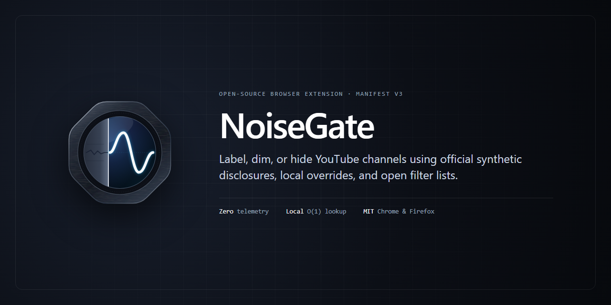

<p align="center">
  
</p>

# NoiseGate

**Label, dim, or hide YouTube channels using official synthetic disclosures, local rules, and open filter lists.**

NoiseGate is an MIT-licensed Manifest V3 browser extension for Chrome, Edge, and Firefox. It operates as a neutral client in the uBlock model: you pick the filter lists you trust, choose how matches look in your feed, and keep full local override over every channel.

---

## Three Layers of Control

1. **Official YouTube Disclosures (Layer 1)**
   YouTube only displays its "Altered or synthetic content" notice inside the video description on the Watch page. NoiseGate detects that disclosure automatically, highlights it beneath the video title, and caches the video and channel locally so the signal stays visible when you return to Home, Search, or Subscriptions.

2. **One-Click Local Rules (Layer 2)**
   Hover over any YouTube video card or use the Watch-page control to mark a channel as **Label**, **Dim**, **Hide**, or **Trust**. Local rules live in `storage.local`, export to plain JSON, and override every subscribed community list.

3. **Subscribable Open Filter Lists (Layer 3)**
   Subscribe to any static HTTPS filter list hosted on GitHub, jsDelivr, or your own server. NoiseGate validates and parses both:
   - **NoiseGate JSON v1** (structured `UC...` channel IDs and `@handles` with neutral categories, notes, and source evidence URLs)
   - **Plain-Text AiSList format** (`! Title:` headers with one `@handle` or `UC...` ID per line)

### Conflict Resolution

- Local rules take priority over every subscribed list, including **Trust** overrides.
- When multiple enabled lists match the same channel, the stricter configured action applies: `Hide > Dim > Label`.
- Hidden cards can be temporarily revealed from the popup in one click for quick inspection.

---

## Privacy and Performance

- **Local O(1) matching:** Filter lists sync periodically via `alarms` into IndexedDB and load into hash maps inside the background service worker.
- **Zero extra YouTube requests:** A lightweight MAIN-world bridge extracts canonical `UC...` channel IDs and `@handles` directly from YouTube's rendered page data.
- **Zero telemetry:** NoiseGate sends zero browsing history, video IDs, or analytics to external servers.

---

## Quick Start (Development Build)

```bash
npm install
npm test
npm run build          # Chrome / Edge MV3 -> .output/chrome-mv3
npm run build:firefox  # Firefox MV3      -> .output/firefox-mv3
```

### Load Unpacked in Chrome or Edge

1. Open `chrome://extensions` and enable **Developer mode**.
2. Click **Load unpacked** and select `.output/chrome-mv3`.
3. Open YouTube. A small bundled 25-channel test sample (drawn from `Override92/AiSList`) is enabled out of the box so you can verify labeling, dimming, hiding, and local overrides right away.

### Load Temporarily in Firefox

1. Open `about:debugging#/runtime/this-firefox`.
2. Click **Load Temporary Add-on** and select `.output/firefox-mv3/manifest.json`.

---

## Community Lists & Two-Repo Architecture

NoiseGate separates extension code from community filter data:

- **Extension Client (`zyniotech/noisegate`)** — Source code, Ultramono-Titanium UI, local topic/signal resolver, tests.
- **Open Filter Lists ([`zyniotech/noisegate-lists`](https://github.com/zyniotech/noisegate-lists))** — CC0-1.0 community topic directory (`registry.json`, JSON v2 catalogs), prefilled Issue Forms, and schema/neutrality validation CI.

---

## Brand & Documentation

- **Privacy Policy:** [PRIVACY.md](./PRIVACY.md)
- **Contributing Guide:** [CONTRIBUTING.md](./CONTRIBUTING.md)
- **Brand Guidelines:** [docs/brand-guidelines.md](./docs/brand-guidelines.md)
- **Design Tokens:** [assets/design-tokens.json](./assets/design-tokens.json) & [assets/design-tokens.css](./assets/design-tokens.css)
- **Store Listing Copy:** [docs/store-listing.md](./docs/store-listing.md)
- **Filter List Contribution Guide:** [lists/CONTRIBUTING.md](./lists/CONTRIBUTING.md)
- **Roadmap & Architecture:** [plan.md](./plan.md)

## License

[MIT](./LICENSE) © 2026 zyniotech
